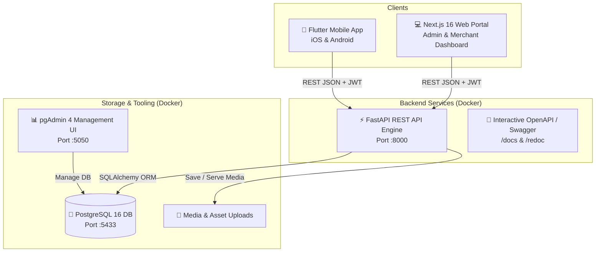

# 🛍️ Full-Stack E-Commerce Platform

[](https://nextjs.org/)
[](https://fastapi.tiangolo.com/)
[](https://flutter.dev/)
[](https://www.postgresql.org/)
[](https://www.docker.com/)

A modern, production-ready, full-stack E-Commerce platform comprising a **Flutter Mobile App**, a **Next.js 16 Admin Dashboard**, and a high-performance **FastAPI REST Backend** backed by **PostgreSQL 16**.

---

## 📑 Table of Contents

- [Overview](#-overview)
- [System Architecture](#-system-architecture)
- [Key Features](#-key-features)
  - [Mobile Application (Customer-Facing)](#-mobile-application-customer-facing)
  - [Web Application (Admin & Merchant Portal)](#-web-application-admin--merchant-portal)
  - [Backend & REST API Engine](#-backend--rest-api-engine)
- [Tech Stack](#-tech-stack)
- [Quick Start Guide](#-quick-start-guide)
  - [Prerequisites](#prerequisites)
  - [One-Click Setup with Docker](#one-click-setup-with-docker)
  - [Running the Flutter Mobile App](#running-the-flutter-mobile-app)
- [Service Ports & Endpoints](#-service-ports--endpoints)
- [Default Demo Credentials](#-default-demo-credentials)
- [Project Directory Structure](#-project-directory-structure)
- [API Documentation](#-api-documentation)
- [Manual Setup (Without Docker)](#-manual-setup-without-docker)
- [Testing](#-testing)
- [License](#-license)

---

## 🌟 Overview

This repository is an end-to-end multi-platform e-commerce solution engineered for scalability, ease of development, and seamless multi-channel commerce:

1. **Mobile App (`mobile-app`)**: Native-feel cross-platform shopping experience built with Flutter and Provider state management.
2. **Web Portal (`web-app`)**: Full-featured admin back-office dashboard built with Next.js 16 (App Router), Tailwind CSS, and Lucide icons.
3. **Backend API (`backend`)**: Fast, asynchronous REST API powered by FastAPI, SQLAlchemy ORM, Alembic migrations, and JWT bearer authentication.
4. **Data Infrastructure**: Containerized PostgreSQL 16 database paired with pgAdmin 4 for visual database management.

---

## 🏛️ System Architecture



---

## ✨ Key Features

### 📱 Mobile Application (Customer-Facing)
- **Authentication & Onboarding**: Clean Welcome, Login, and Sign-Up flows with real-time validation and persistent JWT token management.
- **Discovery & Search**: Hero discount carousels, categorized horizontal pills, search bar with debounce, and product filtering.
- **Product Details**: Multi-variant selector (editions, colors, sizes), dynamic image viewer, customer reviews, ratings summary, and stock checks.
- **Cart & Checkout**: Real-time price breakdown (subtotal, shipping, taxes, discount codes), interactive item count, and multi-step checkout (Credit Card, Apple Pay, Cash on Delivery).
- **Order Management & Tracking**: View active order statuses, past receipts, delivery timelines, and re-order functionality.
- **Favorites & Wishlist**: Bookmark favorite items with one-tap transfer to shopping cart.
- **In-App Notifications**: Real-time notifications for order updates, promotions, and account alerts.
- **User Profile**: Personal profile editing, shipping address book, payment methods, and theme/settings preferences.

### 💻 Web Application (Admin & Merchant Portal)
- **Executive Analytics Dashboard**: KPI metrics (gross revenue, order counts, customer registrations, low-stock warnings) and sales trends.
- **Product & Catalog Management**: Create, edit, and organize products, multi-tier categories, inventory stock levels, and image gallery uploads.
- **Order Processing & Fulfillment**: Filter orders by status (`pending`, `processing`, `shipped`, `delivered`, `cancelled`), manage delivery dates, and track shipping.
- **Inventory & Supply Chain**: Stock balance monitor, stock alert notifications, supplier tracking, and batch updates.
- **Customer & Review Management**: Customer account lookup, purchase history inspection, and product review moderation (approve/reject/flag).
- **Merchant & Seller Management**: Multi-vendor / seller profiles, performance metrics, and commission settings.
- **Notification Center**: System-wide notifications, broadcast messages, unread counters, and mark-all-as-read controls.
- **Security & Session Handling**: Smart JWT expiration checks, automatic stale-session logout, and route protection guards.

### ⚙️ Backend & REST API Engine
- **RESTful Endpoints**: Modular APIRouters covering `/auth`, `/products`, `/categories`, `/orders`, `/cart`, `/reviews`, `/notifications`, `/suppliers`, `/sellers`, `/analytics`, and `/upload`.
- **JWT Authentication & RBAC**: Secure password hashing with Passlib/Bcrypt, access token issuance, and role-based access control (`admin`, `seller`, `customer`).
- **Interactive Documentation**: Auto-generated Swagger UI (`/docs`) and ReDoc (`/redoc`) documentation with live request testing.
- **Database Migrations**: Alembic version-controlled database schema migrations.
- **Automatic Seeding**: Built-in seed data loader pre-populating essential categories, initial products, and test accounts.
- **Health Checks & CORS**: Configured health probe (`/health`) and customizable CORS headers for Flutter emulators and web clients.

---

## 🛠️ Tech Stack

| Layer | Technologies |
|---|---|
| **Mobile App** | Flutter 3.x, Dart 3.x, Provider, HTTP, Shared Preferences, Google Fonts |
| **Web Frontend** | Next.js 16 (App Router), React 19, TypeScript, Tailwind CSS, Lucide Icons, React Icons |
| **Backend API** | FastAPI, Python 3.12, Uvicorn, SQLAlchemy 2.0, Pydantic v2, Passlib, PyJWT |
| **Database** | PostgreSQL 16 Alpine, Alembic (Migrations) |
| **DevOps & Tools** | Docker, Docker Compose, pgAdmin 4 |

---

## 🚀 Quick Start Guide

### Prerequisites
- [Docker Desktop](https://www.docker.com/products/docker-desktop/) (v24.0+)
- [Flutter SDK](https://docs.flutter.dev/get-started/install) (v3.22+ for running the mobile app)
- [Node.js](https://nodejs.org/) (v20+ optional, for local web development without Docker)
- [Python](https://www.python.org/) (v3.12+ optional, for local backend development without Docker)

---

### One-Click Setup with Docker

Clone the repository and launch all backend and web services using the one-click launcher:

```bash
# 1. Clone repository
git clone https://github.com/<your-username>/e-commerce.git
cd e-commerce

# 2. Start all services using the launcher script
chmod +x run.sh
./run.sh
```

*Or run directly with Docker Compose:*

```bash
docker compose up --build -d
```

This starts:
- ✅ **PostgreSQL 16 Database** (Port `5433`)
- ✅ **FastAPI Backend** (Port `8000`)
- ✅ **Next.js Web Portal** (Port `3000`)
- ✅ **pgAdmin 4 UI** (Port `5050`)

---

### Running the Flutter Mobile App

Once the backend is up and running:

```bash
cd mobile-app

# 1. Install dependencies
flutter pub get

# 2. Check connected devices or launch simulator
flutter devices

# 3. Run the app
flutter run
```

> **Note for Android Emulators & Physical Devices:**
> - Android Emulator connects to localhost via `http://10.0.2.2:8000/api`
> - iOS Simulator connects to localhost via `http://127.0.0.1:8000/api`
> - Physical device over Wi-Fi: Update the API base URL in `mobile-app/lib/core/constants/api_constants.dart` with your machine's LAN IP (e.g., `http://192.168.1.X:8000/api`).

---

## 🌐 Service Ports & Endpoints

| Service | URL / Port | Description |
|---|---|---|
| **Next.js Web App** | [http://localhost:3000](http://localhost:3000) | Admin & Merchant Portal |
| **FastAPI Backend** | [http://localhost:8000](http://localhost:8000) | Core REST API Endpoint |
| **Interactive Swagger UI** | [http://localhost:8000/docs](http://localhost:8000/docs) | OpenAPI interactive documentation |
| **Alternative API Docs** | [http://localhost:8000/redoc](http://localhost:8000/redoc) | ReDoc API specifications |
| **Backend Health Check** | [http://localhost:8000/health](http://localhost:8000/health) | Container healthcheck endpoint |
| **pgAdmin 4 Dashboard** | [http://localhost:5050](http://localhost:5050) | PostgreSQL graphical management |
| **PostgreSQL Database** | `localhost:5433` | Database direct connection |

---

## 🔑 Default Demo Credentials

The database is pre-seeded with default administrative and customer accounts:

### Web Admin Portal
- **URL**: [http://localhost:3000/login](http://localhost:3000/login)
- **Email**: `admin@ecommerce.com`
- **Password**: `admin123`
- **Role**: `admin`

### Customer Mobile Account
- **Email**: `customer@ecommerce.com`
- **Password**: `password123`
- **Role**: `customer`

### pgAdmin 4 Management UI
- **URL**: [http://localhost:5050](http://localhost:5050)
- **Login Email**: `admin@ecommerce.com`
- **Login Password**: `admin123`
- **Pre-configured Server**: `PostgreSQL 16 (Local)`
  - **Host**: `postgres`
  - **Port**: `5432`
  - **Database**: `ecommerce_db`
  - **User**: `ecommerce_user`
  - **Password**: `GoPassword_123!`

---

## 📁 Project Directory Structure

```text
e-commerce/
├── backend/                        # FastAPI REST Backend
│   ├── app/
│   │   ├── api/                    # APIRouters (auth, products, orders, etc.)
│   │   ├── core/                   # Security, JWT, config & dependencies
│   │   ├── db/                     # DB session & initial seed data
│   │   ├── models/                 # SQLAlchemy database models
│   │   ├── schemas/                # Pydantic v2 validation schemas
│   │   └── services/               # Business logic & services
│   ├── alembic/                    # Database migrations
│   ├── Dockerfile
│   └── requirements.txt
│
├── web-app/                        # Next.js 16 Admin Dashboard
│   ├── src/
│   │   ├── app/                    # Next.js App Router pages
│   │   │   ├── (admin)/admin/      # Admin dashboard pages (orders, inventory, etc.)
│   │   │   └── (auth)/             # Login and registration pages
│   │   ├── components/             # Reusable UI & Layout components
│   │   └── lib/                    # API client, auth utilities, types
│   ├── Dockerfile
│   └── package.json
│
├── mobile-app/                     # Flutter Mobile Application
│   ├── lib/
│   │   ├── core/                   # Theme, constants, network & utilities
│   │   ├── features/               # Feature-first modules
│   │   │   ├── auth/               # Login, Register, Splash
│   │   │   ├── home/               # Home screen, banners, feeds
│   │   │   ├── product/            # Details, search, category filter
│   │   │   ├── cart/               # Cart, checkout & order summary
│   │   │   ├── orders/             # Order history & status tracking
│   │   │   ├── profile/            # User settings & profile
│   │   │   └── notifications/      # Real-time notification feed
│   │   └── main.dart               # App entrypoint
│   ├── test/                       # Unit & Widget tests
│   └── pubspec.yaml
│
├── pgadmin/                        # pgAdmin auto-server provisioning
│   └── servers.json
├── docker-compose.yml              # Complete multi-service docker orchestration
├── run.sh                          # One-click startup script
└── README.md                       # Project documentation
```

---

## 📖 API Documentation

Once the backend is running, visit:
- **Swagger UI**: [http://localhost:8000/docs](http://localhost:8000/docs)
- **ReDoc UI**: [http://localhost:8000/redoc](http://localhost:8000/redoc)

### Key Endpoints Overview

| Method | Endpoint | Description | Auth Required |
|---|---|---|---|
| `POST` | `/api/auth/register` | Register new account | No |
| `POST` | `/api/auth/login` | Authenticate & get JWT | No |
| `GET` | `/api/auth/me` | Fetch active user profile | Yes |
| `GET` | `/api/products` | Paginated product listing | No |
| `GET` | `/api/products/{id}` | Get product details | No |
| `POST` | `/api/products` | Create product (admin) | Yes (Admin) |
| `GET` | `/api/categories` | List categories | No |
| `GET` | `/api/cart` | Get current user's cart | Yes |
| `POST` | `/api/cart/items` | Add product to cart | Yes |
| `POST` | `/api/orders` | Place a new order | Yes |
| `GET` | `/api/orders` | List user/admin orders | Yes |
| `GET` | `/api/notifications` | User notification list | Yes |
| `GET` | `/api/analytics/overview` | Admin KPI summary | Yes (Admin) |

---

## 💻 Manual Setup (Without Docker)

<details>
<summary><b>Click to expand manual setup instructions</b></summary>

### 1. Database (PostgreSQL)
Ensure PostgreSQL 16 is installed and running locally:
```sql
CREATE DATABASE ecommerce_db;
CREATE USER ecommerce_user WITH PASSWORD 'GoPassword_123!';
GRANT ALL PRIVILEGES ON DATABASE ecommerce_db TO ecommerce_user;
```

### 2. Backend (FastAPI)
```bash
cd backend
python -m venv venv
source venv/bin/activate  # On Windows: venv\Scripts\activate
pip install -r requirements.txt

# Run migrations and seed data
python -c "from app.db.database import init_db; from app.db.seed_data import seed_database; init_db(); seed_database()"

# Start API server
uvicorn app.main:app --host 0.0.0.0 --port 8000 --reload
```

### 3. Web Dashboard (Next.js)
```bash
cd web-app
npm install
npm run dev
```

</details>

---

## 🧪 Testing

### Backend Unit & Integration Tests
```bash
cd backend
pytest
```

### Mobile App Tests (110+ passing unit & widget tests)
```bash
cd mobile-app
flutter test
```

### Flutter Static Analysis
```bash
cd mobile-app
dart analyze lib/
```

---

## 🤝 Contributing

1. Fork the Project
2. Create your Feature Branch (`git checkout -b feature/AmazingFeature`)
3. Commit your Changes (`git commit -m 'Add some AmazingFeature'`)
4. Push to the Branch (`git push origin feature/AmazingFeature`)
5. Open a Pull Request

---

## 📄 License

This project is licensed under the MIT License - see the LICENSE file for details.

